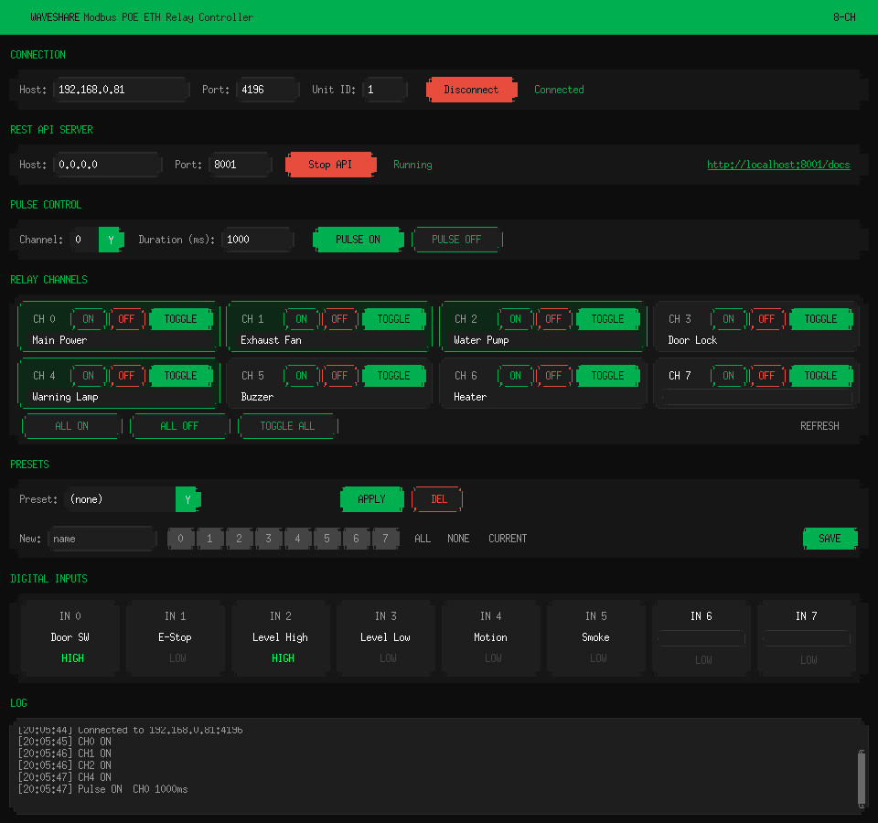
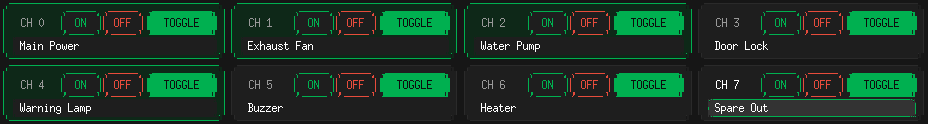
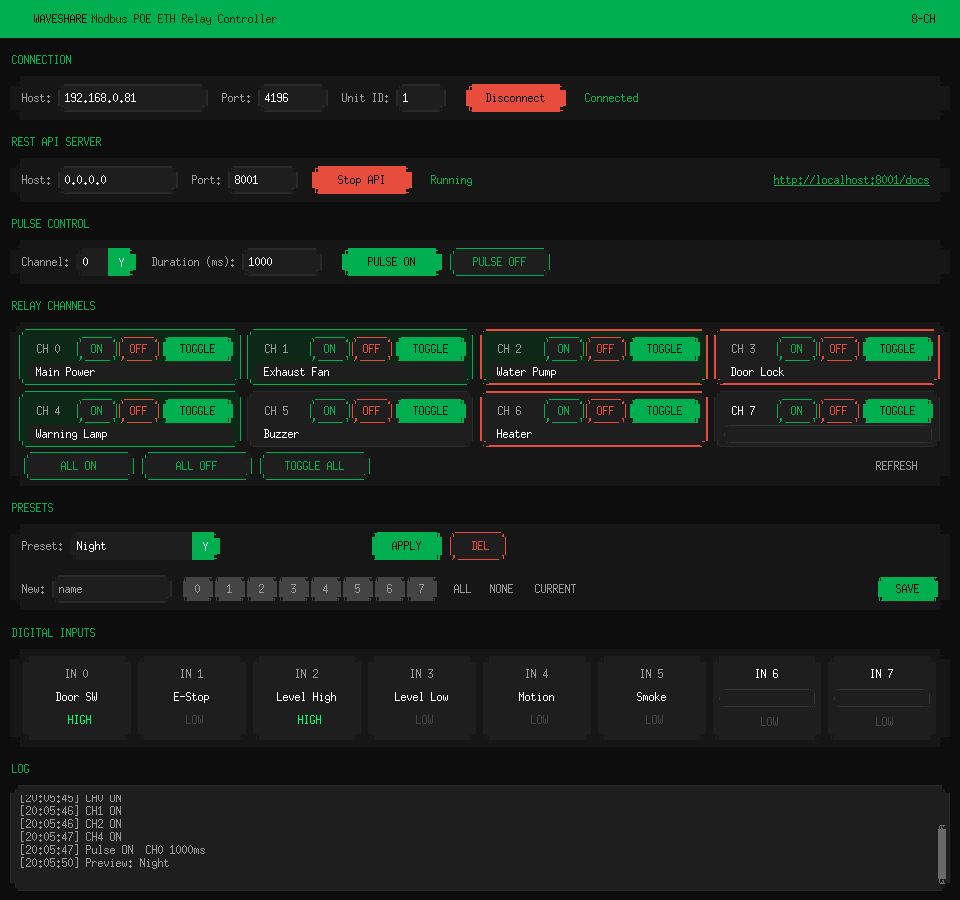

# Waveshare Modbus Relay

A control tool for the **Modbus POE ETH Relay (B)** 8-channel relay module.
It provides both a desktop GUI and a REST API, so the relay can be operated locally or remotely.

- Target device: **Modbus POE ETH Relay (B)** — Waveshare 8-channel PoE/Ethernet relay module
- Official documentation: [Waveshare Wiki — Modbus POE ETH Relay (B)](https://www.waveshare.com/wiki/Modbus_POE_ETH_Relay_(B)?srsltid=AfmBOoqHXIP0lN0ZutTYX2NI9LtfKi_U3Tf3CN_v0MoyoRBxM9kbe5QK#Overview)

---

## Features

- Per-channel ON / OFF / Toggle control
- Bulk control and batch state setting across all channels
- Pulse control — energize/de-energize for a specified duration
- Digital input status reading
- Per-channel control mode (normal / linked) configuration
- Save and apply frequently-used channel states as **Presets**, with a live preview before applying
- Custom **channel names** for relays and digital inputs, saved across restarts
- FastAPI-based REST API served alongside the GUI for remote control and automation

---

## Requirements (important)

This tool operates under the default configuration **only when the device's Transfer Protocol is set to `Modbus_TCP_Protocol`**.
If the device is configured with a different protocol (Modbus RTU over TCP, virtual serial, etc.), the connection will not work correctly.
Please set the Transfer Protocol to `Modbus_TCP_Protocol` from the device's web configuration page.

### Configuration example


Default connection parameters:

| Item | Default |
| ---- | ------- |
| Host (IP) | `192.168.0.81` |
| Port | `4196` |
| Unit ID | `1` |
| Transfer Protocol | `Modbus_TCP_Protocol` |

---

## Installation & Run

This project uses [uv](https://github.com/astral-sh/uv).

```bash
# Install dependencies and run
./run.sh

# Or run directly
uv run waveshare-modbus
```

On launch, the GUI opens and the REST API server starts alongside it.

### Running screen



Relays CH 0, 1, 2 and 4 are ON (green border), and digital inputs IN 0 and IN 2 read HIGH.

### Channel names

Each relay card and digital input cell has a name field below its label.

1. Click the `CH n` / `IN n` label or the name field to start editing.
2. Type a name (relays up to 20 characters, inputs up to 12).
3. Press **Enter** or click elsewhere to save, or **Esc** to cancel.

Clearing the field removes the name. Names are stored in `channel_names.json` and restored on the next launch.



### Preset preview

Selecting a preset from the dropdown outlines in red the channels the preset will turn ON, without changing the relays.
Press **APPLY** to write the preset to the device, or choose `(none)` to clear the preview.



---

## REST API

The API exposes the same functionality as the GUI over HTTP. Key endpoints:

| Method | Path | Description |
| ------ | ---- | ----------- |
| GET    | `/api/status` | Get connection status |
| POST   | `/api/connect` | Connect to the device |
| POST   | `/api/disconnect` | Disconnect |
| GET    | `/api/relays` | Read all relay states |
| GET    | `/api/relays/{ch}` | Read a single relay state |
| POST   | `/api/relays/{ch}/on` \| `/off` \| `/toggle` | Control a single channel |
| POST   | `/api/relays/all/on` \| `/off` \| `/toggle` | Control all channels |
| POST   | `/api/relays/batch` | Set states of all 8 channels at once |
| POST   | `/api/relays/{ch}/pulse` | Pulse control |
| GET    | `/api/inputs` | Read digital input states |
| GET    | `/api/inputs/{ch}` | Read a single digital input |
| GET    | `/api/modes` | Read per-channel control modes |
| PUT    | `/api/modes/{ch}` | Set a channel's control mode |
| GET    | `/api/device/info` | Device address and firmware info |
| GET/POST/DELETE | `/api/presets` | Manage presets |
| POST   | `/api/presets/{name}/apply` | Apply a preset |

Swagger UI: `http://localhost:<port>/docs`

Channel names are a GUI-only setting and are not exposed through the API.

---

## Project structure

```
waveshare-modbus/
├── src/waveshare_modbus/
│   ├── __main__.py           # Entry point
│   ├── gui.py                # CustomTkinter GUI
│   ├── api.py                # FastAPI REST API
│   ├── modbus_client.py      # Modbus TCP client
│   ├── presets.py            # Preset save/load
│   ├── presets.json          # Preset data
│   ├── channel_names.py      # Channel name save/load
│   └── channel_names.json    # Channel name data
├── images/                   # Screenshots
├── run.sh                    # Launch script
└── pyproject.toml
```

---

## License

Released under the [MIT License](LICENSE).
